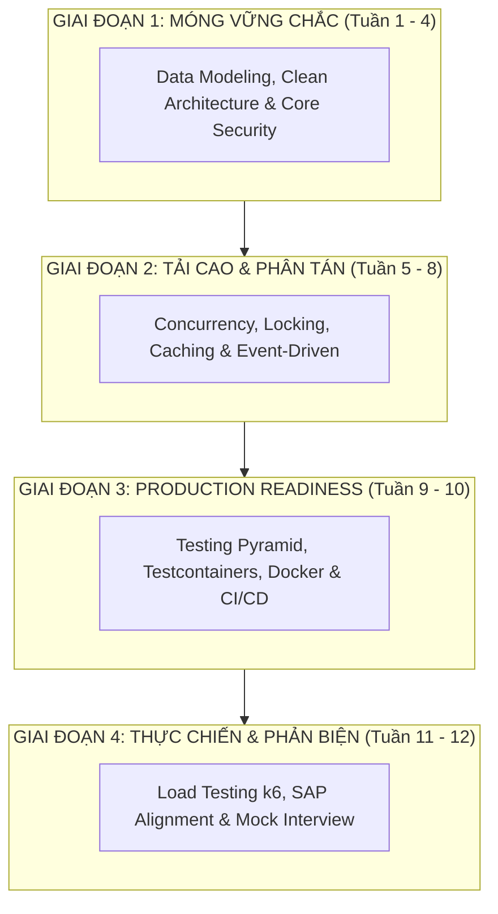

# 🗺️ LỘ TRÌNH TỔNG THỂ 12 TUẦN: CHINH PHỤC SAP STAR 2027

Kế hoạch này được thiết kế theo nguyên lý **Đồng bộ hóa 3 Trục (Symmetrical 3-Pillar Framework)**. Mọi kiến thức lý thuyết học trong tuần sẽ được áp dụng trực tiếp vào dự án **ProcureFlow** và củng cố bằng các dạng bài thuật toán tương ứng, đảm bảo **không chắp vá, không học vẹt, đi từ gốc rễ đến đỉnh cao**.



---

## 📅 CHI TIẾT 12 TUẦN HUẤN LUYỆN

---

### GIAI ĐOẠN 1: THIẾT KẾ NỀN TẢNG & KIẾN TRÚC SẠCH (TUẦN 1 - 4)
> **Mục tiêu cốt lõi:** Làm chủ cơ sở dữ liệu quan hệ, vòng đời bộ nhớ Java, và dựng khung chuẩn mực cho ứng dụng Enterprise Backend.

```
Tuần 1: Data Modeling & Storage Internals
Tuần 2: Clean Architecture & Domain Entities
Tuần 3: Enterprise Security (Spring Security 6 + JWT + RBAC)
Tuần 4: State Machine & Procurement Business Workflow
```

#### Tuần 1: Thiết kế Cơ sở Dữ liệu & Bản chất Lưu trữ
* **DSA (Test Online):** Mảng & Bảng băm (Array & Hash Table).
  * *Bài tập:* Two Sum (LC #1), Contains Duplicate (LC #217), Valid Anagram (LC #242).
* **Lý thuyết CS Core:** 
  * Java Memory Model: Bộ nhớ Stack vs Heap, Object Lifecycle, Garbage Collection (GC) thế hệ (Young/Old/Metaspace).
  * Bản chất `String`: Immutability, String Constant Pool, Thread Safety.
  * Cơ sở dữ liệu: Cấu trúc Data Page (8KB), B-Tree Indexing vs Hash Index, chi phí Disk I/O.
* **Dự án ProcureFlow:**
  * Thiết kế Database Schema chuẩn 3NF: `users`, `roles`, `user_roles`, `suppliers`, `items`, `warehouses`, `inventories`.
  * Áp dụng Snapshot Pattern cho giá trị giao dịch, Audit Columns (`created_at`, `updated_at`), Soft Delete.
  * Viết mã DDL SQL lưu tại `docs/database/V1__initial_schema.sql`.

#### Tuần 2: Clean Architecture & Cơ chế Hibernate/JPA
* **DSA (Test Online):** Con trỏ kép (Two Pointers).
  * *Bài tập:* Valid Palindrome (LC #125), Two Sum II - Input Array Is Sorted (LC #167), 3Sum (LC #15).
* **Lý thuyết CS Core:**
  * Clean Architecture / Hexagonal Architecture: Tại sao tách `Domain`, `Application`, `Infrastructure`, `Presentation`?
  * Hibernate/JPA Internals: Persistence Context, First-level Cache, Entity Lifecycle (`Transient`, `Managed`, `Detached`, `Removed`).
  * Vấn đề kinh điển: **N+1 Query Problem** và cách xử lý (`JOIN FETCH`, `@EntityGraph`).
* **Dự án ProcureFlow:**
  * Khởi tạo cấu trúc dự án Spring Boot 3 (Java 21).
  * Thiết kế các Entity JPA tương ứng với Schema Tuần 1, cấu hình quan hệ `@ManyToOne`, `@ManyToMany` chuẩn chỉ (tránh FetchType.EAGER).
  * Viết Repository và xử lý triệt để N+1 query.

#### Tuần 3: Bảo mật Doanh nghiệp (Enterprise IAM & Spring Security 6)
* **DSA (Test Online):** Cửa sổ trượt (Sliding Window).
  * *Bài tập:* Best Time to Buy and Sell Stock (LC #121), Longest Substring Without Repeating Characters (LC #3).
* **Lý thuyết CS Core:**
  * Cơ chế Spring Security Architecture: `SecurityFilterChain`, `AuthenticationManager`, `UsernamePasswordAuthenticationToken`.
  * Phiên làm việc không trạng thái (Stateless Session) với **JWT (JSON Web Token)**: Cấu trúc Header, Payload, Signature.
  * Cách chống tấn công: XSS, CSRF (khi nào cần disable CSRF?), Brute-force rate limiting.
* **Dự án ProcureFlow:**
  * Cài đặt Spring Security 6 với JWT: Access Token (ngắn hạn) + Refresh Token (dài hạn lưu DB/Redis).
  * Phân quyền theo vai trò (RBAC): `@PreAuthorize("hasRole('APPROVER')")` cho các endpoint nhạy cảm.
  * API Đăng ký, Đăng nhập, Refresh Token, Đổi mật khẩu.

#### Tuần 4: State Machine & Luồng Mua sắm (Procurement Workflow)
* **DSA (Test Online):** Ngăn xếp & Hàng đợi (Stack & Queue).
  * *Bài tập:* Valid Parentheses (LC #20), Min Stack (LC #155), Evaluate Reverse Polish Notation (LC #150).
* **Lý thuyết CS Core:**
  * **State Pattern** vs **Finite State Machine (FSM)** trong hệ thống ERP.
  * Xử lý ngoại lệ tập trung: `@ControllerAdvice`, `@ExceptionHandler`, chuẩn hóa lỗi theo chuẩn **RFC 7807 (Problem Details)**.
  * Quản lý giao dịch: `@Transactional` hoạt động dưới nền tảng ra sao? (Spring AOP Proxy, Transaction Propagation).
* **Dự án ProcureFlow:**
  * Xây dựng luồng tạo Yêu cầu Mua sắm (Purchase Requisition - PR):
    * Trạng thái: `DRAFT` $\to$ `PENDING_APPROVAL` $\to$ `APPROVED` / `REJECTED` $\to$ `ORDERED`.
  * Thiết kế bảng `approval_logs` để ghi nhận toàn bộ lịch sử ai duyệt, duyệt lúc nào, lý do từ chối.
  * Viết API tạo PR, gửi duyệt, phê duyệt theo hạn mức ngân sách (Manager duyệt < \$10,000, Director duyệt $\ge$ \$10,000).

---

### GIAI ĐOẠN 2: XỬ LÝ ĐỒNG THỜI, BỘ NHỚ ĐỆM & HỆ THỐNG PHÂN TÁN (TUẦN 5 - 8)
> **Mục tiêu cốt lõi:** Đào sâu vào Concurrency, ngăn ngừa Race Condition khi trừ kho, và xử lý bất đồng bộ chuẩn Enterprise.

```
Tuần 5: Database Transactions, Concurrency & Data Locking
Tuần 6: Distributed Caching with Redis (Performance Optimization)
Tuần 7: Asynchronous Messaging & Transactional Outbox Pattern
Tuần 8: Advanced Tree / Search Structures in Algorithms
```

#### Tuần 5: Transaction Isolation Levels & Cơ chế Khóa (Locking)
* **DSA (Test Online):** Tìm kiếm nhị phân (Binary Search).
  * *Bài tập:* Binary Search (LC #704), Search a 2D Matrix (LC #74), Find Minimum in Rotated Sorted Array (LC #153).
* **Lý thuyết CS Core (CỰC KỲ QUAN TRỌNG KHI PHỎNG VẤN SAP):**
  * 4 Cấp độ cô lập giao dịch (Transaction Isolation Levels): `Read Uncommitted`, `Read Committed`, `Repeatable Read`, `Serializable`.
  * 3 Hiện tượng lỗi dữ liệu: Dirty Read, Non-repeatable Read, Phantom Read.
  * **Pessimistic Locking** (`SELECT FOR UPDATE`) vs **Optimistic Locking** (`@Version` timestamp/number).
* **Dự án ProcureFlow:**
  * Xây dựng chức năng giữ chỗ tồn kho (Stock Allocation) khi PR được duyệt.
  * Cài đặt cả 2 cơ chế:
    1. Optimistic Locking bằng `@Version` trên Entity `Inventory`.
    2. Pessimistic Write Lock (`LockModeType.PESSIMISTIC_WRITE`) khi tải cao.
  * Đảm bảo không bao giờ bị âm kho dù 100 giao dịch diễn ra cùng mili-giây.

#### Tuần 6: Tối ưu hiệu năng với Distributed Caching (Redis)
* **DSA (Test Online):** Danh sách liên kết (Linked List).
  * *Bài tập:* Reverse Linked List (LC #206), Merge Two Sorted Lists (LC #21), Reorder List (LC #143).
* **Lý thuyết CS Core:**
  * Kiến trúc In-Memory của Redis: Tại sao Redis đơn luồng (Single-threaded) nhưng lại xử lý được hàng trăm nghìn ops/sec? (I/O Multiplexing, Epoll).
  * Các chiến lược Caching: **Cache-Aside**, Write-Through, Write-Behind.
  * 3 Vấn đề kinh điển của Cache:
    * **Cache Penetration** (Truy vấn key không tồn tại).
    * **Cache Avalanche** (Hàng loạt key hết hạn cùng lúc).
    * **Cache Breakdown / Stampede** (Key hot hết hạn đúng lúc tải cao).
* **Dự án ProcureFlow:**
  * Tích hợp Redis vào Spring Cache (`@Cacheable`, `@CacheEvict`) cho danh mục hàng hóa `items` và thông tin `suppliers`.
  * Dùng thư viện **Redisson** để hiện thực **Distributed Lock** khi trừ kho trên môi trường đa instance.

#### Tuần 7: Bất đồng bộ với Message Broker & Transactional Outbox Pattern
* **DSA (Test Online):** Cây nhị phân & Duyệt cây (Binary Tree & DFS/BFS).
  * *Bài tập:* Maximum Depth of Binary Tree (LC #104), Invert Binary Tree (LC #226), Binary Tree Level Order Traversal (LC #102).
* **Lý thuyết CS Core:**
  * Đồng bộ (Synchronous HTTP) vs Bất đồng bộ (Asynchronous Messaging).
  * Kiến trúc Message Broker: **RabbitMQ** (Exchange, Queue, Binding, Routing Key) hoặc **Kafka** (Topic, Partition, Offset).
  * Bài toán phân tán kinh điển: Làm sao đảm bảo vừa lưu DB thành công, vừa gửi tin nhắn an toàn mà không bị mất tin? $\to$ **Transactional Outbox Pattern**.
* **Dự án ProcureFlow:**
  * Dựng RabbitMQ qua Docker.
  * Cài đặt Transactional Outbox Pattern: Khi PR được duyệt, lưu sự kiện `OrderApprovedEvent` vào bảng `outbox_events` cùng Transaction với DB.
  * Dùng Spring `@Scheduled` hoặc CDC để đọc bảng outbox và publish tin nhắn sang RabbitMQ gửi email thông báo cho nhà cung cấp.

#### Tuần 8: Tối ưu hóa truy vấn nâng cao & Bảo đảm toàn vẹn dữ liệu
* **DSA (Test Online):** Cây tìm kiếm nhị phân & Hàng đợi ưu tiên (BST & Priority Queue / Heap).
  * *Bài tập:* Lowest Common Ancestor of a BST (LC #235), Kth Largest Element in an Array (LC #215), Top K Frequent Elements (LC #347).
* **Lý thuyết CS Core:**
  * Composite Indexes (Index tổ hợp): Thứ tự cột trong Index (Leftmost Prefix Rule).
  * Phân tích kế hoạch thực thi truy vấn với **`EXPLAIN ANALYZE`** trong PostgreSQL.
* **Dự án ProcureFlow:**
  * Đánh Composite Index tối ưu cho các câu truy vấn phức tạp (tìm PR theo `status` + `created_at` + `requester_id`).
  * Dùng `EXPLAIN ANALYZE` đo đạc trước và sau khi đánh index để lưu kết quả vào báo cáo kỹ thuật.

---

### GIAI ĐOẠN 3: KIỂM THỬ CHUYÊN SÂU & PRODUCTION READINESS (TUẦN 9 - 10)
> **Mục tiêu cốt lõi:** Biến mã nguồn sinh viên thành mã nguồn chuẩn kỹ sư doanh nghiệp: Có test tự động hóa, đóng gói container và chạy CI/CD.

```
Tuần 9: The Testing Pyramid & Testcontainers (Điểm sáng phỏng vấn)
Tuần 10: Dockerization, Multi-stage Build & GitHub Actions CI
```

#### Tuần 9: Kim tự tháp Kiểm thử (Testing Pyramid) & Testcontainers
* **DSA (Test Online):** Đồ thị cơ bản (Graph BFS & DFS).
  * *Bài tập:* Number of Islands (LC #200), Clone Graph (LC #133), Course Schedule (LC #207).
* **Lý thuyết CS Core:**
  * Testing Pyramid: Unit Test vs Integration Test vs End-to-End Test.
  * Nguyên lý FIRST trong Unit Testing, Mocking với Mockito (`@Mock`, `@InjectMocks`, `@Spy`).
  * **Testcontainers là gì?** Tại sao không nên dùng H2 Database in-memory để test code chạy trên PostgreSQL? (Sự khác biệt về dialect, function, locking).
* **Dự án ProcureFlow:**
  * Viết Unit Tests bao phủ toàn bộ logic nghiệp vụ phê duyệt và tính toán ngân sách (đạt độ phủ code $\ge 80\%$).
  * Viết Integration Test với **Testcontainers**: Tự động kéo Docker container PostgreSQL và Redis thật lên để chạy test các API giữ chỗ tồn kho và transaction rollback.

#### Tuần 10: Đóng gói Docker & Tự động hóa CI Pipeline
* **DSA (Test Online):** Quy hoạch động kinh điển (Dynamic Programming 1D).
  * *Bài tập:* Climbing Stairs (LC #70), House Robber (LC #198), Coin Change (LC #322).
* **Lý thuyết CS Core:**
  * Bản chất Docker: Linux Namespaces (cô lập tiến trình) và Cgroups (giới hạn tài nguyên CPU/RAM).
  * Multi-stage Docker Build: Tại sao dùng multi-stage để giảm image từ 800MB xuống còn 150MB? (Distroless / Alpine JRE).
  * Continuous Integration (CI): Kiểm soát chất lượng mã nguồn tự động trước khi merge code.
* **Dự án ProcureFlow:**
  * Viết `Dockerfile` Multi-stage tối ưu dung lượng cho Spring Boot.
  * Viết file `docker-compose.yml` hoàn chỉnh: Khởi chạy 1 lệnh duy nhất là dựng toàn bộ cụm `Postgres`, `Redis`, `RabbitMQ` và `ProcureFlow Backend`.
  * Viết file GitHub Actions workflow (`.github/workflows/ci.yml`): Tự động checkout code, cài đặt JDK 21, chạy toàn bộ Unit/Integration Tests mỗi khi push code lên GitHub.

---

### GIAI ĐOẠN 4: ĐO KIỂM HIỆU NĂNG, ĐỒNG BỘ SAP & PHẢN BIỆN (TUẦN 11 - 12)
> **Mục tiêu cốt lõi:** Có số liệu thực tế chứng minh hệ thống chịu tải cao, sẵn sàng tâm lý đè bẹp các vòng phỏng vấn của SAP Labs.

```
Tuần 11: High-Concurrency Load Testing với k6 & Monitoring
Tuần 12: SAP Ecosystem Alignment, CV Polish & Mock Interviews
```

#### Tuần 11: Đo kiểm tải cao (Load Testing với k6) & Giám sát hệ thống
* **DSA (Test Online):** Tổng ôn thuật toán tốc độ cao (Speed Run HackerRank simulation).
  * Luyện giải các đề tổng hợp 2 bài trong 60 phút dưới áp lực thời gian.
* **Lý thuyết CS Core:**
  * Các chỉ số đo lường hiệu năng: Throughput (RPS), Latency (p50, p95, p99), Error Rate.
  * Giám sát với **Spring Boot Actuator**, **Prometheus** và biểu đồ **Grafana**.
* **Dự án ProcureFlow:**
  * Viết kịch bản test bằng công cụ **k6** (Javascript):
    * Giả lập **500 người dùng đồng thời (500 VUs)** cùng bấm mua một mặt hàng chỉ còn tồn kho 5 sản phẩm.
  * Chụp lại biểu đồ: Chứng minh không có sản phẩm nào bị bán âm, các giao dịch tranh chấp được xếp hàng hoặc từ chối chính xác (0 data corruption).
  * Đưa biểu đồ này vào phần README của dự án!

#### Tuần 12: Hoàn thiện Hồ sơ, Đồng bộ Hệ sinh thái SAP & Phỏng vấn thử
* **Hồ sơ & GitHub:**
  * Viết `README.md` chuẩn quốc tế bằng tiếng Anh: Có sơ đồ kiến trúc Mermaid, video/GIF demo API, bảng so sánh benchmark hiệu năng, hướng dẫn chạy 1 lệnh Docker.
  * Tinh chỉnh CV 1 trang chuẩn ATS, làm nổi bật các từ khóa: *Concurrency Control, Pessimistic Locking, Redis Distributed Lock, Testcontainers, Event-Driven*.
* **SAP Alignment:**
  * Mở tài khoản *SAP Learning Hub Student Edition* đã được kích hoạt: Hoàn thành bài nhập môn SAP CAP để hiểu cách liên hệ kiến trúc Spring Boot của bạn với nền tảng SAP BTP.
* **Mock Interviews (Phỏng vấn thử với Mentor):**
  * Buổi 1: Phỏng vấn Kỹ thuật sâu (Soi từng dòng code, hỏi dồn dập về trade-offs, deadlock, transaction).
  * Buổi 2: Phỏng vấn Quản lý & HR (Trả lời bằng phương pháp STAR, giải thích động lực vào SAP STAR 2027).

---

## 🏆 KẾT QUẢ ĐẠT ĐƯỢC SAU 12 TUẦN

1. **Vòng Test Online (OA):** Nắm vững toàn bộ các dạng bài LeetCode Easy/Medium hay ra của HackerRank/SHL, tự tin giải quyết trong 45–60 phút.
2. **Vòng Phỏng vấn Kỹ thuật:** Hiểu sâu bản chất mọi công nghệ từ bộ nhớ Java, Database Index, Transaction đến Distributed System, không bao giờ bị "bắt bài" khi hỏi *Under the hood*.
3. **Dự án cá nhân:** Sở hữu một hệ thống Backend Doanh nghiệp đỉnh cao, có kiến trúc rõ ràng, Unit/Integration Test tự động, Docker hóa và có số liệu chứng minh chịu tải thực tế.
